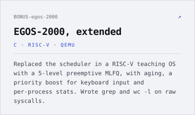
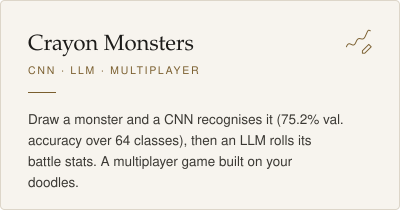
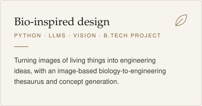
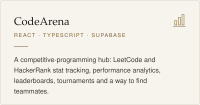
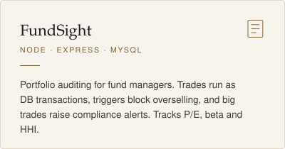
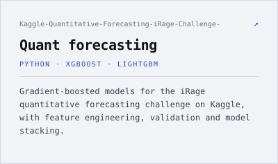
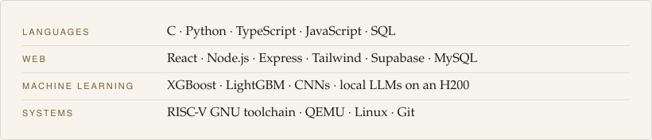

  <picture><source media="(prefers-color-scheme: dark)" srcset="assets/header-dark.svg" /><source media="(prefers-color-scheme: light)" srcset="assets/header-light.svg" /></picture>

I'm a third-year Computer Science & Applied Mathematics student at IIIT Delhi. I like work that sits close to the machine — kernels, schedulers, RISC-V tooling — and work that leans on mathematics: vision models, LLM pipelines and forecasting. Right now that means my B.Tech project on bio-inspired design, Kaggle, and Codeforces.

### Selected work

<table>
  <tr>
    <td width="50%"><a href="https://github.com/abhishek24024/BONUS-egos-2000"><picture><source media="(prefers-color-scheme: dark)" srcset="assets/card-egos-dark.svg" /><source media="(prefers-color-scheme: light)" srcset="assets/card-egos-light.svg" /></picture></a></td>
    <td width="50%"><a href="https://github.com/abhishek24024/Crayon-Monsters"><picture><source media="(prefers-color-scheme: dark)" srcset="assets/card-crayon-dark.svg" /><source media="(prefers-color-scheme: light)" srcset="assets/card-crayon-light.svg" /></picture></a></td>
  </tr>
  <tr>
    <td width="50%"><a href="https://github.com/abhishek24024/To-develop-bio-inspired-solutions-using-the-images-of-biological-entities-"><picture><source media="(prefers-color-scheme: dark)" srcset="assets/card-bio-dark.svg" /><source media="(prefers-color-scheme: light)" srcset="assets/card-bio-light.svg" /></picture></a></td>
    <td width="50%"><a href="https://github.com/abhishek24024/CodeArena"><picture><source media="(prefers-color-scheme: dark)" srcset="assets/card-codearena-dark.svg" /><source media="(prefers-color-scheme: light)" srcset="assets/card-codearena-light.svg" /></picture></a></td>
  </tr>
  <tr>
    <td width="50%"><a href="https://github.com/abhishek24024/FundSight"><picture><source media="(prefers-color-scheme: dark)" srcset="assets/card-fundsight-dark.svg" /><source media="(prefers-color-scheme: light)" srcset="assets/card-fundsight-light.svg" /></picture></a></td>
    <td width="50%"><a href="https://github.com/abhishek24024/Kaggle-Quantitative-Forecasting-iRage-Challenge-"><picture><source media="(prefers-color-scheme: dark)" srcset="assets/card-kaggle-dark.svg" /><source media="(prefers-color-scheme: light)" srcset="assets/card-kaggle-light.svg" /></picture></a></td>
  </tr>
</table>

Also: a RISC-V assembler and simulator, and a university ERP system.

### Toolbox

<picture><source media="(prefers-color-scheme: dark)" srcset="assets/toolbox-dark.svg" /><source media="(prefers-color-scheme: light)" srcset="assets/toolbox-light.svg" /></picture>

### Contributions

<picture>
  <source media="(prefers-color-scheme: dark)" srcset="https://raw.githubusercontent.com/abhishek24024/abhishek24024/output/github-snake-dark.svg" />
  <source media="(prefers-color-scheme: light)" srcset="https://raw.githubusercontent.com/abhishek24024/abhishek24024/output/github-snake.svg" />
  
</picture>

### Correspondence

<i>θ ← θ − η∇L(θ) — still converging.</i>

