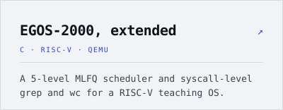
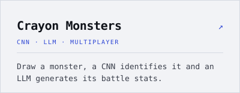
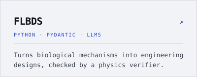
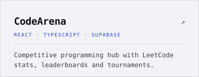
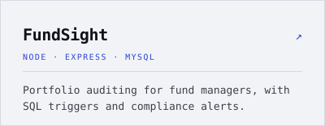
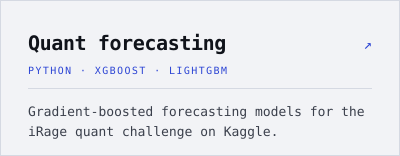
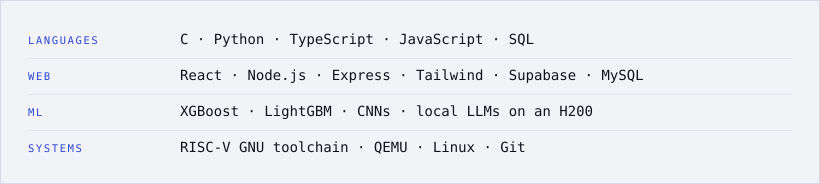

  <picture><source media="(prefers-color-scheme: dark)" srcset="assets/header-dark-v2.svg" /><source media="(prefers-color-scheme: light)" srcset="assets/header-light-v2.svg" /></picture>

Third-year B.Tech student in Computer Science and Applied Mathematics at IIIT Delhi. I work on operating systems and RISC-V tooling, and on machine learning: vision models, LLM pipelines and forecasting. At the moment I'm building FLBDS for my B.Tech project and spending the rest of my time on Kaggle and Codeforces.

### Projects

<table>
  <tr>
    <td width="50%"><a href="https://github.com/abhishek24024/BONUS-egos-2000"><picture><source media="(prefers-color-scheme: dark)" srcset="assets/card-egos-dark-v2.svg" /><source media="(prefers-color-scheme: light)" srcset="assets/card-egos-light-v2.svg" /></picture></a></td>
    <td width="50%"><a href="https://github.com/abhishek24024/Crayon-Monsters"><picture><source media="(prefers-color-scheme: dark)" srcset="assets/card-crayon-dark-v2.svg" /><source media="(prefers-color-scheme: light)" srcset="assets/card-crayon-light-v2.svg" /></picture></a></td>
  </tr>
  <tr>
    <td width="50%"><a href="https://github.com/abhishek24024/FLBDS"><picture><source media="(prefers-color-scheme: dark)" srcset="assets/card-flbds-dark-v2.svg" /><source media="(prefers-color-scheme: light)" srcset="assets/card-flbds-light-v2.svg" /></picture></a></td>
    <td width="50%"><a href="https://github.com/abhishek24024/CodeArena"><picture><source media="(prefers-color-scheme: dark)" srcset="assets/card-codearena-dark-v2.svg" /><source media="(prefers-color-scheme: light)" srcset="assets/card-codearena-light-v2.svg" /></picture></a></td>
  </tr>
  <tr>
    <td width="50%"><a href="https://github.com/abhishek24024/FundSight"><picture><source media="(prefers-color-scheme: dark)" srcset="assets/card-fundsight-dark-v2.svg" /><source media="(prefers-color-scheme: light)" srcset="assets/card-fundsight-light-v2.svg" /></picture></a></td>
    <td width="50%"><a href="https://github.com/abhishek24024/Kaggle-Quantitative-Forecasting-iRage-Challenge-"><picture><source media="(prefers-color-scheme: dark)" srcset="assets/card-kaggle-dark-v2.svg" /><source media="(prefers-color-scheme: light)" srcset="assets/card-kaggle-light-v2.svg" /></picture></a></td>
  </tr>
</table>

Also: a RISC-V assembler and simulator, and a university ERP system.

### Stack

<picture><source media="(prefers-color-scheme: dark)" srcset="assets/stack-dark-v2.svg" /><source media="(prefers-color-scheme: light)" srcset="assets/stack-light-v2.svg" /></picture>

### Contributions

<picture>
  <source media="(prefers-color-scheme: dark)" srcset="https://raw.githubusercontent.com/abhishek24024/abhishek24024/output/github-snake-dark.svg" />
  <source media="(prefers-color-scheme: light)" srcset="https://raw.githubusercontent.com/abhishek24024/abhishek24024/output/github-snake.svg" />
  
</picture>

### Contact

<a href="https://www.linkedin.com/in/abhishek-tripathi-14b1153b9/"><picture><source media="(prefers-color-scheme: dark)" srcset="assets/linkedin-dark-v2.svg" /><source media="(prefers-color-scheme: light)" srcset="assets/linkedin-light-v2.svg" /></picture></a>
